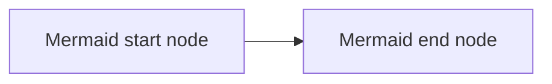

# Diagrams Fixture

A document with each of GitHub's diagram block types (M7).

## Mermaid



## GeoJSON

```geojson
{
  "type": "FeatureCollection",
  "features": [
    {
      "type": "Feature",
      "properties": { "name": "Square" },
      "geometry": {
        "type": "Polygon",
        "coordinates": [[[0, 0], [10, 0], [10, 10], [0, 10], [0, 0]]]
      }
    }
  ]
}
```

## TopoJSON

```topojson
{
  "type": "Topology",
  "arcs": [[[0, 0], [10, 0], [0, 10], [-10, 0], [0, -10]]],
  "objects": {
    "square": { "type": "GeometryCollection", "geometries": [{ "type": "Polygon", "arcs": [[0]] }] }
  }
}
```

## STL

```stl
solid tetrahedron
  facet normal 0 0 -1
    outer loop
      vertex 0 0 0
      vertex 1 0 0
      vertex 0 1 0
    endloop
  endfacet
  facet normal 0 -1 0
    outer loop
      vertex 0 0 0
      vertex 0 0 1
      vertex 1 0 0
    endloop
  endfacet
  facet normal -1 0 0
    outer loop
      vertex 0 0 0
      vertex 0 1 0
      vertex 0 0 1
    endloop
  endfacet
  facet normal 1 1 1
    outer loop
      vertex 1 0 0
      vertex 0 0 1
      vertex 0 1 0
    endloop
  endfacet
endsolid tetrahedron
```

The end.
